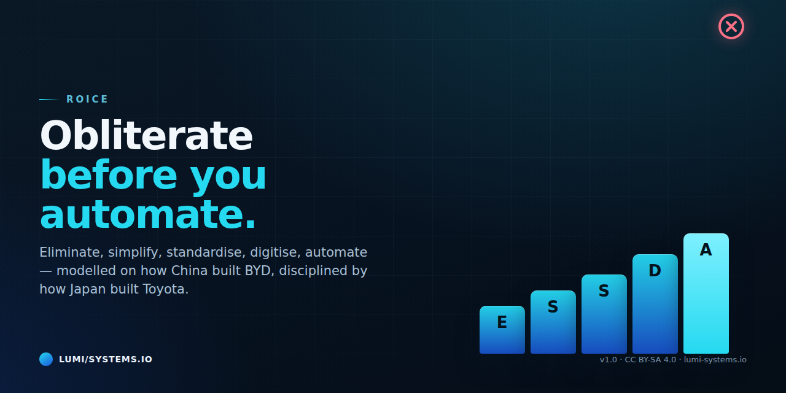

# ROICE

**Reengineering · Optimisation · Integration · Consolidation · Engineering**

A procedure for rebuilding how work is done — before automating it. Written for organisations that
are about to spend real money on AI and automation, and for the people who have to live with the
result.



## The thesis

Automating a process you have not understood automates its defects, locks in its complexity, and
removes the slack that made it survivable. The order matters more than the tool.

ROICE is not a product and not a certification. It is a loop, a ladder, a set of laws and a
governance model for one job: *take a process apart to the last step, understand why every step
exists, then rebuild it with fewer parts, fewer handoffs and fewer failure points.*

## The loop

```
FRAME → R → O → I → C → E → KEEP
        └─────── kaikaku ───────┘  └─ kaizen ─┘
```

| Phase | One question | One artefact |
|---|---|---|
| **Frame** | What exactly, and who owns it? | Process Charter |
| **R** | What is really there? | Teardown Manual + Element Inventory |
| **O** | What should not exist? | Complexity-Reduction Backlog |
| **I** | Make, buy, share, or keep separable? | Integration Matrix + Lifecycle Ledger |
| **C** | How do we collapse the variety? | Consolidation Roadmap |
| **E** | How do we make it stick and improve? | Engineering Specification + Cockpit |
| **Keep** | Is the gain surviving? | Odometer review record |

## The ladder — never skip a rung

```
E  Eliminate     Does this element need to exist at all?
S  Simplify      Can it be smaller, fewer, flatter?
S  Standardise   Can it be the same every time?
D  Digitise      Can the data move without a human?
A  Automate      Only now.
```

## The fourteen laws

| # | Law |
|---|---|
| 1 | Part count is destiny — remove the element, save at every stage at once |
| 2 | Obliterate before you automate |
| 3 | Common beats special — one design used four times |
| 4 | Integrate where it compounds; keep interfaces where repair matters |
| 5 | Optimise the whole lifecycle, not the factory gate |
| 6 | Without a standard there is no improvement |
| 7 | Build quality in; stop the line rather than pass the defect |
| 8 | Flow beats batch — but slack is not waste |
| 9 | Go and see. Measure the process, not the report |
| 10 | Small disciplined decisions compound; there is no clever trick |
| 11 | Speed of learning is the only durable moat |
| 12 | People are the process. Capability is not headcount |
| 13 | Every redesign must leave the organisation better at redesigning |
| 14 | Measure the odometer, not the brochure |

**Conflict order:** 4 and 5 beat 1 and 3 · 14 beats any unmeasured benefit claim · 7 beats 8.

## The seven cost classes

```
build · operate · maintain · repair · change · exit · risk
```

Every change posts to **all seven**, even where the post is zero. A class that gets worse needs a
**named acceptor** — a person, not a department.

## The three separation rules

1. The teardown lead is **not** the process owner.
2. Whoever measures a benefit is **not** whoever claims it.
3. Whoever writes a change to the framework is **not** whoever certifies it.

## The four maxims

1. **Self-certification is not verification** — the reviewer is a different context.
2. **A channel that cannot turn red has verified nothing** — and a false red destroys its authority.
3. **Format compliance is not integrity.**
4. **"New to me" is not "unsubstantiated"**, and "it is on a curated list" is not evidence.

## Stop rules

| Stop if | Because |
|---|---|
| Materiality is not met at gate O | A framework that must find savings will find them |
| An element lacks an E verdict | Automation would freeze a defect |
| A trade-off has no named acceptor | The cost will be paid silently |
| The horizon or discount rate is renegotiated per proposal | The comparison is no longer valid |
| The engagement becomes a headcount programme | Capability is not a cost (Law 12) |
| No mechanical channel can be built | The effectiveness score is capped, and that must be said |

## The cockpit

Eight slots, never more: element count · lead time · queue ratio · first-time-right · lifecycle cost
index · change lead time · capability index · odometer hit rate.

**Every efficiency metric is paired with a quality or capability metric.** A dashboard that shows
only speed teaches people to go faster in the wrong direction.

## Applying it to AI work

The ladder does not stop at software. For an AI system, the same five rungs apply:

1. **Eliminate** — does this step need a model at all? Can the decision be removed, or made by rule?
2. **Simplify** — fewer inputs, fewer outputs, one question per component.
3. **Standardise** — one prompt pattern, one output contract, one evaluation per task class.
4. **Digitise** — data moves without a human typing it twice.
5. **Automate** — and only now, with the evaluation from the earlier rungs.

Most AI projects start at rung 5. That is why they are expensive to change afterwards.

## Adoption worksheet

```
[ ] Element count is frozen and counted twice
[ ] Every element has a one-sentence justification with a name
[ ] The queue ratio is computed
[ ] Every integration has a lifetime and a repair cost
[ ] Every trade-off has a named acceptor
[ ] Every gate criterion has evidence, not opinion
[ ] Every benefit is on the Odometer Register with a date
[ ] A mechanical channel ran, and it can go red
```

## What this is not

- Not a certification, badge or standard. The artefacts are the evidence.
- Not a promise of savings. Law 14 exists because most claimed savings never survive production.
- Not a headcount programme. Capability is not a cost.

## License

Text: **CC BY-SA 4.0** · Code and scripts: **MIT**. See [LICENSE](LICENSE).
